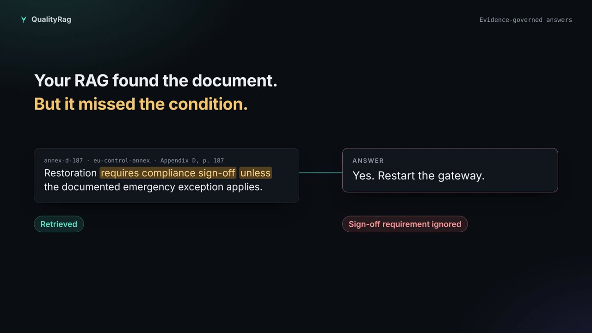
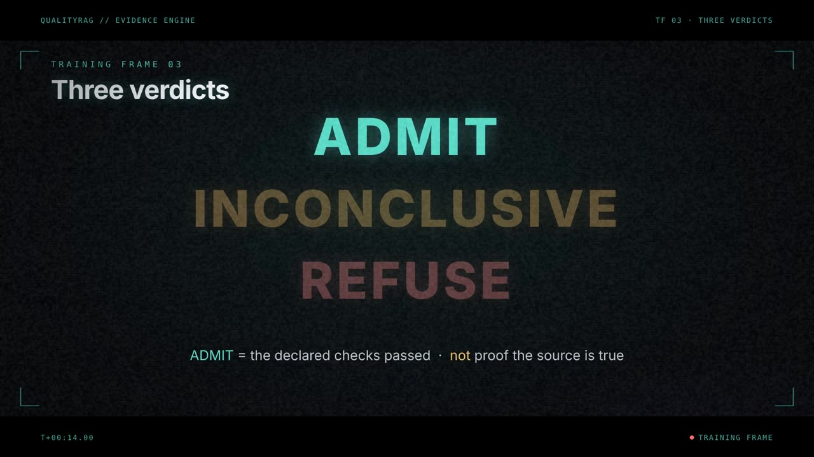
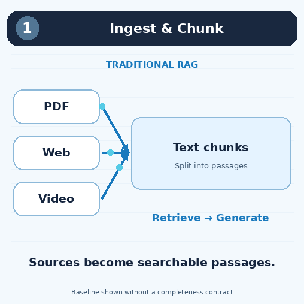
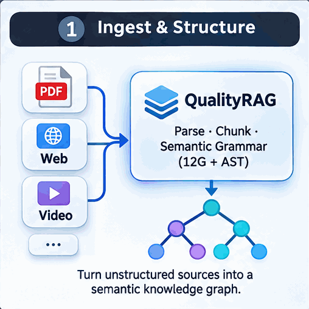

# QualityRag

**Evidence-governed RAG and a growing Semantic Garden for grammar and activation research through RCT.**

QualityRag evaluates a versioned **PackSpec** against retrieved evidence **before** an answer is produced. The SDK uses the same portable contract in Python, Java, and TypeScript/React.

**Status:** Experimental v0.1. Local, deterministic policy evaluator; not a proof of source authenticity, truth, regulatory compliance, or production readiness. No LLM is required for evaluation.

## Watch QualityRAG in action

The fastest way to understand QualityRAG is to watch an evidence check fail safely, then see what additional evidence changes.

| 51-second overview | The Evidence Engine — 2 min 12 sec |
| --- | --- |
| [](docs/training/homepage-45s/qualityrag-homepage-45s.mp4) | [](docs/training/film-01-evidence-engine/qualityrag-the-evidence-engine.mp4) |
| **[Watch the short overview](docs/training/homepage-45s/qualityrag-homepage-45s.mp4)** · [Captions (VTT)](docs/training/homepage-45s/qualityrag-homepage-45s.vtt) | **[Watch the full narrated film](docs/training/film-01-evidence-engine/qualityrag-the-evidence-engine.mp4)** · [Captions (VTT)](docs/training/film-01-evidence-engine/qualityrag-the-evidence-engine.vtt) |

**Learn by doing:** [Getting started (3-minute video)](docs/training/episode-01-getting-started/episode-01-getting-started.mp4) · [QualityRAG Academy — 11 video-and-lab chapters](docs/academy/README.md) · [Complete training video catalog](docs/training/README.md).

*Click a thumbnail to open its narrated MP4. GitHub README pages show the poster links, not an arbitrary embedded HTML video player. The videos illustrate the current evidence gate and distinguish experimental research concepts from validated SDK behavior.*

## See the difference

| Traditional RAG | QualityRAG |
| --- | --- |
|  |  |
| Retrieves relevant passages and generates an answer from the selected context. | Evaluates the PackSpec's declared evidence requirements before admitting an answer; missing or conflicting evidence can prevent admission. |

The traditional RAG animation depicts a representative baseline **without an explicit completeness contract**; RAG implementations can add their own guardrails. The QualityRAG animation illustrates the broader architecture, including the Semantic Garden's intended continuous grammar and activation research loop. It is not evidence that the full autonomous loop, semantic accuracy or compression superiority has been validated. Admission concerns declared requirements and supplied evidence metadata, not a guarantee of truth.

## Semantic Garden: a continuous RCT research loop

The central research deliverable is an agent-driven system that repeatedly finds, tests and retains better representation regimes while preserving the meaning required by the same PackSpec. **Grammar and activation evolve together.** A fixed codec, deterministic proposal roles or a predefined palette search alone do not fulfill this goal.

1. **Find failure:** identify lost distinctions, excessive representation or activation costs, and cases that perform worse than AV1.
2. **Investigate the regime:** record the constraints, representation choices and counterexamples that explain the failure.
3. **Propose changes:** agents revise grammar rules, reusable structures, residual strategies, activation dependencies and paired encoder/decoder behavior.
4. **Run controlled experiments:** compare each candidate with the current champion and AV1 on held-out families under the same PackSpec. Record setup, representation, activation and research costs; leave unmeasured costs explicit.
5. **Retain knowledge:** keep hypotheses, lineage, counterexamples, negative experiments and the conditions under which each result holds. The research tree keeps growing.
6. **Promote or reopen:** retain qualified, versioned research champions and reopen failed or dormant branches when new evidence warrants investigation.

Activation includes what is reconstructed, which modules load, their order and their resource constraints. **AV1 is the baseline and fallback, not the endpoint.** Untouched AV1 fallback can preserve its byte-size floor; it does not establish an advantage in latency, energy, total research cost or semantic compression.

### Executable implementation and current limits

The [continuous research engine](docs/CONTINUOUS-RCT-GARDEN.md) connects persistent Garden branches and the Research Ledger to a host-configured open-model proposer, bounded encoding/activation experiments, fresh evaluation cohorts and research-champion history. Its first backend learns source-bound literal productions and composes reversible operators with eager or on-demand chunk activation. Exact source reconstruction is checked, and unknown decoder installation cost forces original-source fallback.

```bash
python -m tools.activation_runtime.evolution \
  --garden /absolute/workspace/gardens/research/events.sqlite \
  --config /absolute/research-config.json \
  --model YOUR_INSTALLED_OPEN_MODEL --continuous --work-limit 200
```

Use the guide's explicit source-family splits and objective configuration. The worker runs until stopped, a budget is exhausted or a provider fails; without fresh evaluation families, it can continue development but cannot promote a research champion.

**Acceptance boundary:** this implementation is a first reversible research backend. It does not yet demonstrate the full autonomous semantic improvement loop, a mature video grammar or superiority over AV1. Scripted lifecycle tests and a provider protocol fixture do not substitute for a live model experiment. Earlier “software-complete” story counts describe component evidence, not fulfillment of that system-level goal. Research promotion grants neither semantic admission nor production release.

## How QualityRAG works (animated)


**The key difference from ordinary RAG:** documents retrieved from the same origin do not automatically count as independent corroboration. QualityRAG checks the **versioned PackSpec** against the supplied evidence metadata *before* the application decides whether to generate an answer. Insufficient evidence results in **INCONCLUSIVE**, not an invented confident answer. **ADMIT** means the supplied inputs pass the declared checks; it does **not** prove that their sources are truthful.

The final animation frame shows the **separate, experimental Semantic Garden** research loop for grammar and activation ideas. This is not a capability of the stable evidence-gate SDK, and research results are not promoted automatically.

[Read the walkthrough and regenerate the GIF](docs/README-ANIMATION.md)


## Credibility is visibility and control

QualityRAG Studio's evidence-assurance promise is **inspectable source coverage, owner-controlled retrieval, and independently challengeable verdicts**—not a persuasive AI confidence score. For personal Drive sources, users can inspect which files were indexed or skipped, exclude an indexed source from private lexical search, preserve that exclusion across resync, review a local control history, and export an unsigned visibility report. **Exclusion is not erasure and search inclusion is not evidence approval.**

[Customer visibility and control acceptance contract](docs/CREDIBILITY-VISIBILITY-CONTROL.md)

### Protected services: visible, fail-closed evidence ingress

An administrator can explicitly opt a service/environment into
`QUALITYRAG_PROTECTED_DRIVE_SERVICES`. The registry then **rejects every
unreviewed generic evidence submission** for that scope and records a
metadata-only denial in the local evidence ledger. Studio shows the protection
mode, blocked-attempt count, and remaining enforcement limits. A ledger
activation marker blocks a silent downgrade on restart.

```sh
npm --prefix apps/registry install
npm --prefix apps/registry run protection:demo
```

**[Protection setup, security boundaries and customer acceptance test](docs/PROTECTED-DRIVE-INGRESS.md)**.
Generic unreviewed submissions remain blocked. A separately enabled **human-signed
protected admission path** can accept customer-approved assertions after exact live
Google byte checks, current owner permissions and two independently pinned Ed25519
role signatures. It does **not** establish objective semantic truth, original
publisher authenticity, or enforcement in external inference applications.

```sh
npm --prefix apps/registry run admission:demo
```

**[Offline dual-signing, Studio submission and independent Python receipt verification](docs/PROTECTED-HUMAN-REVIEW-ADMISSION.md)**.
The pilot supports one asserted origin per requirement and does not claim original
publication freshness; stronger PackSpecs fail closed.

### Evidence is approved once, but authorization is checked **every time**

A signed historical `ADMIT` cannot override a later customer exclusion.
For integrated applications, the registry exposes a **request-specific
evidence-use check**: it re-verifies the current approved PackSpec,
both signed review approvals, source owner controls and exact live
Google file bytes before returning a permit bound to the proposed
answer's SHA-256. A TypeScript `ProtectedUseClient` releases that
exact answer only when the permit matches; no raw answer is uploaded.

```sh
npm --prefix apps/registry run admission:demo
npm --prefix sdk/typescript test
```

[Just-in-time source revocation, SDK integration and strict limits](docs/PROTECTED-EVIDENCE-USE.md).
**The permit does not evaluate the answer's semantic correctness and
cannot control external applications that bypass this gate.**

### Owner source controls reach the policy boundary

Beyond suppressing private search hits, Studio now offers a **server-side governed candidate check**: an authorized Drive user selects an indexed source and an approved PackSpec requirement for the active service/environment. The registry checks the *actual owner-controlled index*, source revision, anchor and source-exclusion status against the server-resolved PackSpec. Excluded sources return `REFUSE`. Included-but-unreviewed sources return `INCONCLUSIVE`, not `ADMIT`, because semantic support and source provenance have not been independently authenticated.

```sh
npm --prefix apps/registry install
npm --prefix apps/registry run drive:governed-demo
```

[Policy-bound gate semantics, limits and customer acceptance challenge](docs/CREDIBILITY-VISIBILITY-CONTROL.md). **This gate applies to the dedicated per-user Drive path, not to arbitrary external RAG applications or generic telemetry events.**

## Personal Google Drive configuration in QualityRAG Studio

Studio now includes **My cloud drives**: a per-user Google OAuth connection, encrypted server-side account records, folder browsing, explicit source-folder selection, metadata preview, and disconnect. **After explicitly choosing a folder**, a user can opt into a separate encrypted, per-user text index, sync up to 40 eligible Google Docs/TXT/Markdown/CSV/JSON files, search for anchored lexical matches, and open the original Google file. The existing Semantic Store remains a single-user research worker; this private text index is **not yet its full semantic grammar or embeddings**.

**[Setup, privacy, explicit indexing and security constraints](docs/STUDIO-PER-USER-DRIVE.md)**. Requires administrator-configured Google OAuth and OIDC identities. Google currently requests account-wide read-only access; folder selection is an application-level constraint, not a folder-scoped OAuth grant. Connection **alone** never downloads content. PDF/media ingestion, OneDrive and Dropbox adapters, live change watching, and production tenant-isolated storage are not yet implemented.

## Evidence Assurance: show me the decision

QualityRAG Studio now has two distinct evidence-review views: **recorded opt-in telemetry** and a **synthetic challenge lab**. The recorded view shows the bound PackSpec, requirement-level reasons, declared source-origin tokens, a same-server replay and a separate customer review disposition. It does **not** prove that sources are authentic or that the policy is complete.

Run the actual registry HTTP challenge locally (requires `npm --prefix apps/registry install`):

```sh
npm --prefix apps/registry run evidence:demo
```

The synthetic experiment records three citations with **one declared origin** (INCONCLUSIVE), adds an independent declared source (ADMIT), replays the first verdict, and appends a distinct review disposition.

To reproduce the recorded decision **with the separate Python SDK**, export a metadata-only receipt from that same HTTP demonstration:

```sh
npm --prefix apps/registry run evidence:demo -- --export /tmp/qualityrag-review.json
PYTHONPATH=sdk/python python -m qualityrag.verify_receipt /tmp/qualityrag-review.json
```

The verifier recomputes the result from the exported policy, opaque source metadata and original evaluation time. The embedded digest is not proof of authenticity; an out-of-band trusted digest is needed to authenticate the package. This is a synthetic evidence-verification demonstration, **not** a source-authenticity or regulatory-compliance certification.
 This is a runnable demonstration with mock identities, **not** live customer telemetry or independently attested evidence.

### Adversarial custody challenge: a fake independent source

The registry's original metadata-only replay can reproduce an **invented origin label**. Run the source custody challenge to see an attacker change a one-origin `INCONCLUSIVE` result into a self-consistent `ADMIT` that **passes ordinary replay**, while a separately signed customer-reviewed source mapping rejects the forged origin:

```sh
python -m pip install -r tools/packspec_compiler/requirements.txt
npm --prefix apps/registry install
python scripts/evidence-custody-show-me.py
```

This reuses QualityRAG's existing QR-CJSON-1 Ed25519 signed-attestation mechanism and RCT v1.9 exact-byte custody concepts. The demonstration uses **synthetic data and ephemeral keys**. A signed claim does not prove an original publisher, real-world source independence or semantic truth.

**[Customer-controlled source custody challenge](docs/EVIDENCE-CUSTOMER-SOURCE-CUSTODY.md)** · **[Telemetry API, Studio setup, and production limitations](docs/EVIDENCE-TELEMETRY-REGISTRY.md)** · **[Acceptance-workflow design](docs/EVIDENCE-ASSURANCE-TELEMETRY.md)**

## PackSpec configuration choices

Keep your policy **inside the application**, supply it as a **JSON property or mounted file**, or manage versions centrally through **QualityRag Studio**. All approaches use the same evidence evaluator; the Java SDK includes an explicit, fail-closed source selector.

**[PackSpec source configuration guide](docs/PACKSPEC-SOURCES.md)** (Java, Python, TypeScript) · **[Studio registry](docs/STUDIO-REGISTRY.md)**

## Decision semantics

- **ADMIT**: all declared requirements have valid supporting evidence under the supplied metadata.
- **REFUSE**: a requirement is contradicted or an explicit violation has been recorded.
- **INCONCLUSIVE**: evidence is absent, stale, source-dependent when independence is required, unverified, or lacks required coverage.

**ADMIT only means the supplied input satisfies the specified checks; it never proves the underlying source is truthful.** Integrators should refuse or ask for more evidence on either REFUSE or INCONCLUSIVE.

## Repository

- `contracts/qualityrag.schema.json` – portable PackSpec, witness, and evaluation contract
- `sdk/python` – zero-dependency Python engine and tests
- `sdk/java` – Java 17 Maven SDK with Jackson and JUnit
- `sdk/typescript` – TypeScript SDK and React hook
- `examples/` – shared input and expected result

## Try it

Then take the **[QualityRag Academy](docs/academy/README.md)**: eleven problem-driven chapters, each with a cinematic episode, a real lab, a war game and a quiz.

New here? Watch **[QualityRag 101, episode 1: Getting started](docs/training/README.md)**, a three-minute animated walkthrough of installing, signing in, and checking your first answer.


Python (from repository root):

```sh
PYTHONPATH=sdk/python python -m unittest discover -s sdk/python/tests
PYTHONPATH=sdk/python python examples/python_demo.py
```

Java: `cd sdk/java && mvn test`

TypeScript: `cd sdk/typescript && npm install && npm test && npm run build`

## Source lineage and scope

Concepts adapted from private APX implementation as of 2026-11-02:

| Capability | APX reference | Public v0.1 |
| --- | --- | --- |
| Versioned policy | `packages/apx-pack-spec` | Simplified portable PackSpec |
| Evidence lineage | `packages/apx-evidence` | Origin key + source reference |
| Decision and refusal | `packages/apx-assurance` | Deterministic ADMIT/REFUSE/INCONCLUSIVE |
| Independent corroboration | `packages/apx-evidence` | Distinct origin count |
| D15 deception census | `packages/apx-evidence` | **Not yet ported** |
| HCR, RCOC, TERM, W_min, receipts | APX assurance stack | **Not yet ported** |

No private infrastructure, credentials, customer records, or private APX source tree is included. See `docs/ROADMAP.md` for parity criteria.

## Security

Only metadata and bounded evidence identifiers belong in receipts. Validate upstream source authority; do not count repeated copies as independent corroboration. Apply access control to documents before indexing/retrieval. Avoid logging retrieved content or sensitive data.

## Research lineage and references

**Cyrille Eloundou** — APX framework author and research reference for the PackSpec, semantic governance, constraint-verification, and provenance concepts that informed QualityRag.

**APX project:** [apx.guide](https://apx.guide/) · [QualityRag enterprise retrieval training](docs/TRAINING.md) · [Reproducible example](examples/enterprise-rag/README.md)

QualityRag adapts concepts from APX for evidence-completeness decisions in RAG. It is a separate, experimental implementation. The APX website describes its own research and product claims; those claims are not independent validation of QualityRag's effectiveness.

## License

Apache-2.0. See `LICENSE`.

## Learn why QualityRag exists

Start with the **[training guide: five RAG failure scenarios, the case for deterministic evidence gates, and a runnable lab](docs/TRAINING.md)**. It explains when QualityRag is useful, what its current SDKs guarantee, and where their limitations remain.

## Source PackSpec compiler (experimental)

The [source PackSpec compiler](tools/packspec_compiler/README.md) inspects original APX YAML, JSON and text-bearing PDF specifications, preserves source fingerprints and locations, and creates **review-required constraint inventories**. Only explicitly reviewer-mapped evidence-presence obligations can be projected into a v0.1 QualityRag policy. It does **not** implement the full APX semantic grammar or automatically approve claims.

## APX PackSpec-derived examples in ten languages

The [APX example collection](examples/apx-packspecs/README.md) provides twelve verified metadata-gate scenarios based on SEMLOAN, Question Fan, FFI and software-selling PackSpecs, with corresponding examples for Java, Python, TypeScript, Go, C#, Rust, Kotlin, PHP, Ruby and Swift. They **project** the original semantic contracts into the experimental v0.1 evidence format; the SDKs do not execute the full originals.

## Signed Studio policy promotion (experimental)

The [signed Studio promotion guide](apps/registry/SIGNED-PROMOTION.md) explains offline Ed25519 signing, trust-store configuration, staged → approved → published policy distribution and signed-only Python client verification. The registry stores **public keys only**, never governance private keys. Its shared bearer token and local file storage remain development-grade; production RBAC, attested evidence custody and multi-instance sequence coordination are not yet implemented.

## Registry identity and independent policy approval

[OIDC governance and scoped RBAC](apps/registry/OIDC-GOVERNANCE.md) introduces verified JWT identities, separate policy author/approver/publisher roles, three-person signed promotion, and a local SHA-256 audit chain. The file-backed registry is still a single-writer development service; database transactions, interactive Studio login and independent audit anchoring remain outstanding.

## Transactional signed-policy promotions

The [PostgreSQL signed-promotion ledger](apps/registry/POSTGRES-SIGNED-LEDGER.md) implements service/environment row locking and atomic promotion/audit transactions for multiple registry instances. It is an opt-in **signed-only** backend; unsigned legacy operations explicitly fail rather than using file storage. PostgreSQL provisioning, independent audit anchoring and production deployment remain outside this implementation.

## Operational signed-registry readiness

The [PostgreSQL deployment and recovery runbook](apps/registry/DEPLOYMENT-RUNBOOK.md) describes checksummed advisory-locked migration, fail-closed startup, liveness/readiness probes, and a non-root registry container. It does not provision production database, identity or signing credentials.

