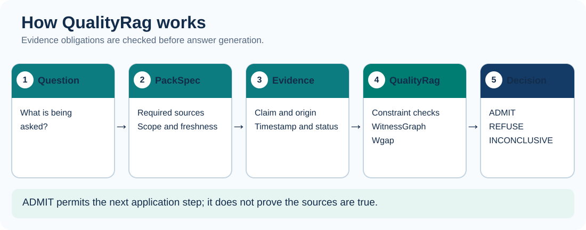
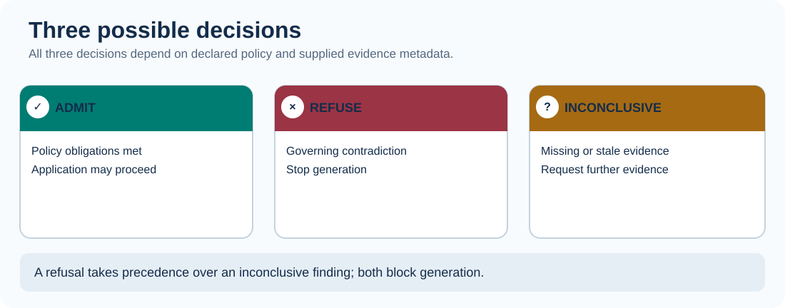

# QualityRag Documentation

> **Start here.** QualityRag is an experimental, deterministic evidence gate for RAG applications. It evaluates *declared evidence metadata*, not the truth of retrieved information.

**[Quickstart](quickstart.md)** · **[SDK guides](#choose-your-sdk)** · **[Concepts & API](concepts.md)** · **[FAQ](troubleshooting.md)** · **[Support](support.md)**

---

## Get started in three steps

| Step | What to do | Link |
| :--- | :--- | :--- |
| **01 — Understand** | Learn `ADMIT`, `REFUSE`, and `INCONCLUSIVE` | [Concepts & decision contract](concepts.md) |
| **02 — Run** | Evaluate a small PackSpec against evidence | [Five-minute quickstart](quickstart.md) |
| **03 — Integrate** | Choose your runtime and gate model execution | [SDK guides](#choose-your-sdk) |

## Choose your SDK

**Backend and enterprise**

| Language | Getting started | Test from repository root |
| :--- | :--- | :--- |
| **Java 17** | [Java SDK →](languages/java.md) | `mvn -f sdk/java/pom.xml test` |
| **Python** | [Python SDK →](languages/python.md) | `PYTHONPATH=sdk/python python -m unittest discover -s sdk/python/tests` |
| **Go 1.22** | [Go SDK →](languages/go.md) | `cd sdk/go && go test ./...` |
| **C# / .NET 8** | [C# SDK →](languages/csharp.md) | `dotnet run --project sdk/csharp/QualityRag.Smoke` |
| **Rust** | [Rust SDK →](languages/rust.md) | `cd sdk/rust && cargo test` |
| **Kotlin** | [Kotlin SDK →](languages/kotlin.md) | `cd sdk/kotlin && gradle test` |

**Web, application, and scripting**

| Language | Getting started | Test from repository root |
| :--- | :--- | :--- |
| **TypeScript / React** | [TypeScript SDK →](languages/typescript.md) | `cd sdk/typescript && npm install && npm test` |
| **PHP 8.3** | [PHP SDK →](languages/php.md) | `php sdk/php/conformance.php` |
| **Ruby 3.3** | [Ruby SDK →](languages/ruby.md) | `ruby sdk/ruby/test/test_conformance.rb` |
| **Swift 5.9** | [Swift SDK →](languages/swift.md) | `cd sdk/swift && swift test` |

## Understand an evaluation

| Decision | Meaning | Recommended application behavior |
| :--- | :--- | :--- |
| **ADMIT** | Submitted metadata satisfies the declared policy | The *policy gate* permits the next step; apply other safety checks |
| **REFUSE** | Governing contradiction found | Do not generate an answer; return relevant reason |
| **INCONCLUSIVE** | Required evidence is missing or insufficient | Do not generate an answer; surface the gap |

> [!IMPORTANT]
> **ADMIT is not proof of source authenticity or answer correctness.** Distinct origin labels do not establish real independence. Enforce admission in trusted backend code, not solely in a React component.

## Capabilities and maturity

| Capability | Availability |
| :--- | :--- |
| Deterministic v0.1 metadata gate | **All 10 SDKs** |
| Shared seven-scenario conformance fixtures | **All 10 SDKs** |
| ConstraintIR · WitnessGraph · Wgap | **Java, Python, TypeScript** |
| Spring Boot answer gate | **Java** |
| Spring AI integration | **In review — PR #9** |
| D15 / G1–G12 / HCR complete parity | **Not implemented** |

These libraries are currently built **from repository source**. No public language package registry release is claimed.

## Explore further

| Topic | Documentation |
| :--- | :--- |
| PackSpec fields and reason codes | [Concepts & API reference](concepts.md) |
| Troubleshooting and common questions | [FAQ and troubleshooting](troubleshooting.md) |
| Reporting issues and security concerns | [Support](support.md) |
| Cross-language decision fixtures | [Conformance](CONFORMANCE.md) |
| Server-side Java integration | [Spring Boot](SPRING-BOOT.md) |
| Compiler design | [Architecture decision record](ADR-0001-semantic-constraint-compiler.md) |

---

[Repository home](../README.md) · [License](../LICENSE) · [Open issues](https://github.com/cyrillesaxo/QualityRag/issues)
