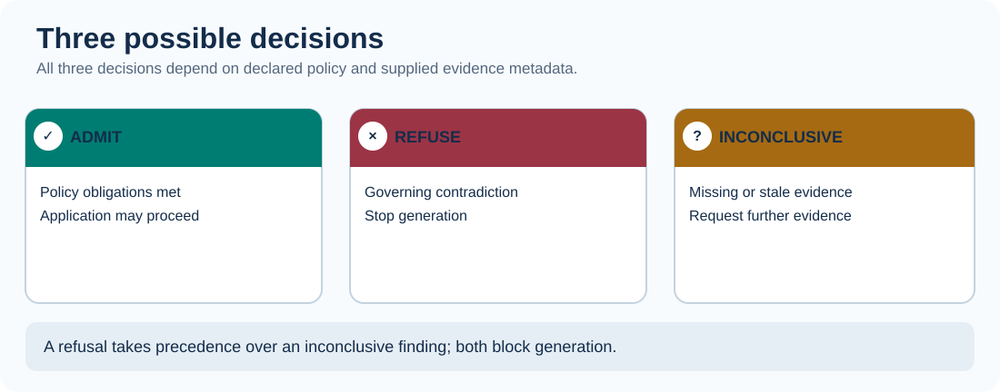

# QualityRag Training: Why It Exists, What It Does, and When to Use It

**Audience:** application developers, Java/Spring Boot architects, RAG engineers, technical reviewers, and policy owners  
**Level:** beginner → intermediate · **Time:** approximately 25–35 minutes  
**Scope:** experimental QualityRag metadata gate and the Java/Python/TypeScript semantic compiler prototype

> **Key idea:** A retrieved passage can be accurate and relevant yet still be **insufficient to justify an answer**. Retrieval success is not evidence completeness.

## Learning outcomes

After this lesson, you should be able to:
1. Explain the difference between *having a source*, *having relevant evidence*, and *satisfying all governing requirements*.
2. Identify five ways an apparently plausible RAG answer can be unjustified.
3. Model evidence obligations as a versioned PackSpec and interpret `ADMIT`, `REFUSE`, and `INCONCLUSIVE`.
4. Recognize what the current implementation **does not** verify.
5. Gate generation in application code and identify what additional evidence is needed.

## 1. The problem: plausible answers are not always justified

A typical retrieval-augmented generation (RAG) pipeline is:

```text
User question → retrieval → selected passages → language model → answer
```

Retrieval can return genuine, relevant passages. But *relevance* does not establish that all applicable conditions were retrieved. A response may omit an exception, mix jurisdictions, cite obsolete rules, count copies as corroboration, or silently promote an unverified claim to fact.

For high-consequence workflows, asking the model to “be careful” is insufficient as an **enforcement mechanism**: the application needs explicit conditions that can stop answer generation when required evidence is not established. QualityRag adds this *policy gate*:

```text
Question + declared PackSpec → required evidence obligations
Retrieved evidence + provenance metadata → QualityRag evaluation
                         ├─ ADMIT        → application may generate (other safeguards still apply)
                         ├─ REFUSE       → do not generate; show governing contradiction
                         └─ INCONCLUSIVE → do not generate; show missing evidence / Wgap
```

This is complementary to retrieval improvements, citations, model evaluation, and human review—not a replacement for them.

## 2. Side-by-side walkthrough: Traditional RAG vs QualityRag

This example uses a **fictional company reimbursement policy**, not a real employer's rules.

> **Employee question:** "Can I be reimbursed for a $1,200 laptop bought for remote work?"

Two governing policy passages exist:

| Policy passage | Fictional rule |
| :--- | :--- |
| General reimbursement rule | Remote employees can be reimbursed for equipment up to **$1,500**. |
| Purchase approval exception | Purchases **above $1,000** require manager approval **before purchase**. |

### Path A — Traditional RAG, missing the exception

```text
Employee asks about $1,200 laptop
       ↓
Retriever finds the $1,500 general limit
       ↓
Model sees the correct but incomplete passage
       ↓
Possible answer: "Yes, $1,200 is under $1,500."
       ↓
⚠ Unsupported conclusion: prior manager approval was not checked
```

This is an illustrative **failure possibility**, not a claim that every standard RAG system would answer incorrectly. Better retrieval could find both passages.

### Path B — RAG with a QualityRag policy gate

The policy owner configures **both evidence obligations** in QualityRag Studio or a versioned PackSpec. Retrieval still finds only the general rule.

```text
Employee asks about $1,200 laptop
       ↓
Retriever finds the $1,500 general limit
       ↓
QualityRag checks the PackSpec:
  ✓ general-reimbursement-rule: supporting evidence found
  ? purchase-approval-exception: no evidence supplied
       ↓
INCONCLUSIVE — block unsupported answer generation
       ↓
Application asks for the missing approval-policy evidence
```

The key architectural difference: **traditional retrieval returns what was found; QualityRag can enforce what the policy says must be found before generation**.



### PackSpec for the example

```json
{
  "id": "equipment-reimbursement",
  "version": "1.0",
  "requirements": [
    {
      "id": "general-reimbursement-rule",
      "min_independent_sources": 1
    },
    {
      "id": "purchase-approval-exception",
      "min_independent_sources": 1
    }
  ]
}
```

### Run the existing Python SDK

From the repository root:

```bash
PYTHONPATH=sdk/python python - <<'PY'
from qualityrag import evaluate

pack = {
    "id": "equipment-reimbursement",
    "version": "1.0",
    "requirements": [
        {"id": "general-reimbursement-rule"},
        {"id": "purchase-approval-exception"},
    ],
}

# Retrieval only supplies the broad rule.
evidence = [{
    "id": "witness-1",
    "requirement_id": "general-reimbursement-rule",
    "origin": "company-policy",
    "source_ref": "equipment-policy#general",
    "status": "SUPPORTS",
    "observed_at": "2026-11-02T10:00:00Z",
}]

result = evaluate(pack, evidence, as_of="2026-11-02T10:05:00Z")
assert result["verdict"] == "INCONCLUSIVE"
assert {f["requirement_id"]: f["verdict"] for f in result["findings"]} == {
    "general-reimbursement-rule": "ADMIT",
    "purchase-approval-exception": "INCONCLUSIVE",
}
print(result["verdict"])
for finding in result["findings"]:
    print(finding["requirement_id"], finding["verdict"])
PY
```

Expected output:

```text
INCONCLUSIVE
general-reimbursement-rule ADMIT
purchase-approval-exception INCONCLUSIVE
```

**Important:** This test exercises the **metadata evaluator**, not an LLM or a live retriever. To prevent generation in production, the application must enforce the decision on its trusted server, before invoking the model.

### Comparison

| Question | Traditional RAG | RAG with QualityRag |
| :--- | :--- | :--- |
| Can it retrieve relevant text? | Yes | Yes; uses the application's retriever |
| Does relevance guarantee completeness? | No | No |
| Can it require specific declared evidence obligations? | Not inherently | **Yes** |
| Can it block generation when a declared exception is missing? | Requires additional application logic | **Yes, with server-side gating** |
| Does it automatically discover an undeclared exception? | Not guaranteed | **No, not in the current SDK** |
| Does it certify source truth or the final answer? | No | **No** |

> [!IMPORTANT]
> **QualityRag does not magically know the exception.** The policy owner must explicitly declare `purchase-approval-exception` in the PackSpec. This limitation is essential to interpreting the example accurately.

---

## 3. Five worked examples

All scenarios below are **fictional training examples**. They are *not* actual medical, employment, eligibility, financial, or legal rules.

### Example A — The hidden exception

**Question:** “Does the applicant qualify?”

**Retrieved passage:** “Applicants who complete the core application qualify.”

**Additional governing rule:** “Applicants must also provide an up-to-date identity-verification document.”

**Naive failure:** A system answers “Yes” using the true but incomplete core rule.

**QualityRag contract:** The policy owner declares two obligations, `core-rule` and `verification-exception`. The first has evidence; the second does not.

**Result:** `INCONCLUSIVE` with an unresolved `verification-exception` obligation.

**Why it matters:** Correct citation of the broad rule is not proof that required exceptions have been evaluated.

**Important limit:** The current implementation cannot automatically discover an exception that nobody declared in the PackSpec. That requires policy authoring, retrieval checks, and future semantic machinery.

### Example B — Two documents, one origin

**Question:** “Has this product requirement been independently confirmed?”

**Evidence:** Doc A and Doc B both repeat a statement from the same bulletin.

**Naive failure:** The application treats two retrieved documents as two independent confirmations.

**PackSpec:** `min_independent_sources: 2`.

**Result:** `INCONCLUSIVE` because both witness records have the **same declared origin**.

**Why it matters:** More citations do not necessarily mean more independent evidence.

**Limit:** Caller-provided origin strings must themselves be verified upstream. Two different labels could still conceal a common source.

### Example C — An outdated source

**Question:** “What is the current version of this process?”

**Evidence:** A document supports the policy but was last observed outside the permitted 24-hour freshness window.

**PackSpec:** `max_age_seconds: 86400`.

**Result:** `INCONCLUSIVE` with `STALE_EVIDENCE` and insufficient current support.

**Why it matters:** Historical accuracy does not automatically justify a claim about the present.

**Limit:** `observed_at` is a timestamp supplied by the evidence collector, not independent proof that the underlying facts are current.

### Example D — A governing contradiction

**Question:** “Can this operation proceed?”

**Evidence:** One governing record supports the operation, while another applicable record contradicts it.

**Result:** `REFUSE` with `CONTRADICTION`, even if there are enough supporting origins.

**Why it matters:** Counting supporting documents cannot erase an unresolved governing contradiction.

**Limit:** Scope and authority must be established; an irrelevant, fabricated, or out-of-scope contradiction should not silently become a governing fact.

### Example E — Wrong scope, convincing answer

**Question:** “Is the requirement satisfied in Region B?”

**Evidence:** The retrieved record applies only to Region A.

**Extended PackSpec:** A requirement with `scope: "Region-B"`.

**Result:** The experimental Java/Python/TypeScript semantic compiler reports `SCOPE_MISMATCH` and `INCONCLUSIVE`.

**Why it matters:** Transferring a valid rule into the wrong jurisdiction, actor, timeframe, or product can invalidate the conclusion.

**Limit:** The base v0.1 gate in all ten languages does not yet enforce the extended scope field; use the extended compiler where available.

## 3. Hands-on lab — duplicate provenance

Create this PackSpec:

```json
{
  "id": "training.duplicate-origin",
  "version": "1",
  "requirements": [
    {
      "id": "independent-confirmation",
      "min_independent_sources": 2,
      "max_age_seconds": 3600
    }
  ]
}
```

And provide these two witness records:

```json
[
  {
    "id": "doc-1",
    "requirement_id": "independent-confirmation",
    "origin": "bulletin-A",
    "source_ref": "example:bulletin-A:copy-1",
    "status": "SUPPORTS",
    "observed_at": "2026-11-02T10:00:00Z"
  },
  {
    "id": "doc-2",
    "requirement_id": "independent-confirmation",
    "origin": "bulletin-A",
    "source_ref": "example:bulletin-A:copy-2",
    "status": "SUPPORTS",
    "observed_at": "2026-11-02T10:00:00Z"
  }
]
```

Run this example from the repository root:

```bash
PYTHONPATH=sdk/python python - <<'PY'
from qualityrag import evaluate

pack = {
    "id": "training.duplicate-origin", "version": "1",
    "requirements": [
        {"id": "independent-confirmation",
         "min_independent_sources": 2, "max_age_seconds": 3600}
    ]
}
evidence = [
    {"id": "doc-1", "requirement_id": "independent-confirmation",
     "origin": "bulletin-A", "source_ref": "example:bulletin-A:copy-1",
     "status": "SUPPORTS", "observed_at": "2026-11-02T10:00:00Z"},
    {"id": "doc-2", "requirement_id": "independent-confirmation",
     "origin": "bulletin-A", "source_ref": "example:bulletin-A:copy-2",
     "status": "SUPPORTS", "observed_at": "2026-11-02T10:00:00Z"}
]
result = evaluate(pack, evidence, as_of="2026-11-02T10:05:00Z")
assert result["verdict"] == "INCONCLUSIVE"
print(result)
PY
```

**Experiment:** Replace the second witness's declared origin with `bulletin-B`. The evaluator now returns `ADMIT` *under the supplied metadata*. Ask yourself: who verified that Bulletin B was genuinely independent? That check belongs upstream.

## 4. What “admission” actually means

| Decision | Meaning | Recommended behavior |
| :--- | :--- | :--- |
| `ADMIT` | Declared metadata obligations are satisfied | Proceed only if all other application safeguards allow it |
| `REFUSE` | A governing contradiction is recorded | Block the answer and expose bounded reasons |
| `INCONCLUSIVE` | At least one required obligation is unresolved | Block the answer and request targeted evidence |

**Never interpret ADMIT as “the answer is true.”** It does not certify facts, ensure an exhaustive PackSpec, or evaluate the final generated answer.

## 5. Why not rely on RAG improvements alone?

| Technique | Useful for | What it does not guarantee |
| :--- | :--- | :--- |
| Better chunking / search | Finding relevant passages | Every governing exception has been retrieved |
| Reranking | Prioritizing likely relevant passages | Independent source provenance |
| Prompt instructions | Influencing generation style | Deterministic refusal when evidence is incomplete |
| Citations | Showing where a statement came from | Scope, freshness, or completeness of justification |
| LLM-as-judge | Evaluating candidate answers | A reproducible, source-authenticated policy decision |
| **QualityRag** | Enforcing *declared* evidence requirements before generation | Automatically discovering unknown policies or proving source truth |

QualityRag is most useful where a wrong-but-plausible answer has a meaningful cost and the required evidence can be expressed explicitly.

## 6. When QualityRag is a good fit

Consider using it for governed knowledge assistants, enterprise decision-support, regulated operational procedures, audit support, approval workflows, and retrieval systems that need traceable reasons for abstaining.

For low-stakes creative writing or casual chat, a pre-generation policy gate may add more complexity than value. Adoption should follow measured false-admission risk, policy coverage, operator cost, and latency—not a generic claim that every RAG system needs this software.

## 7. Current implementation vs roadmap

| Capability | Available today? |
| :--- | :--- |
| Metadata evidence checks and three-way decisions | Yes: all ten SDK foundations |
| Shared v0.1 conformance scenarios | Yes |
| Scope/authority-labeled ConstraintIR, WitnessGraph groups, Wgap | Experimental: Java, Python, TypeScript |
| Spring Boot answer gate | Yes |
| Central QualityRag Studio and local service/policy registry | Yes, local development prototype |
| Java remote-policy resolution | Under review in PR #12 |
| Automatic unknown-exception discovery | No |
| Full APX deceptive-witness D15, G1–G12, HCR and semantic completeness proof | No |
| Independently authenticated source provenance | No |
| Production-ready signed central policy distribution | No |

## 8. Knowledge check

1. Three web pages quote the same official bulletin. Do you have three independent origins? **No, not necessarily.**
2. The general rule is correct but a declared exception has not been retrieved. What is the verdict? **INCONCLUSIVE.**
3. One valid governing witness contradicts three supporting witnesses. What is the verdict? **REFUSE.**
4. Is an `ADMIT` decision proof that the final LLM answer is correct? **No.**
5. Does a PackSpec automatically know all relevant exceptions? **No; policy completeness must be established separately.**

## Continue learning

- [Main documentation](README.md)
- [Quickstart](quickstart.md)
- [Concepts and reason codes](concepts.md)
- [APX-inspired architecture](ADR-0001-semantic-constraint-compiler.md)
- [Standalone Studio / registry](STUDIO-REGISTRY.md)
- [Cross-language fixtures](CONFORMANCE.md)
