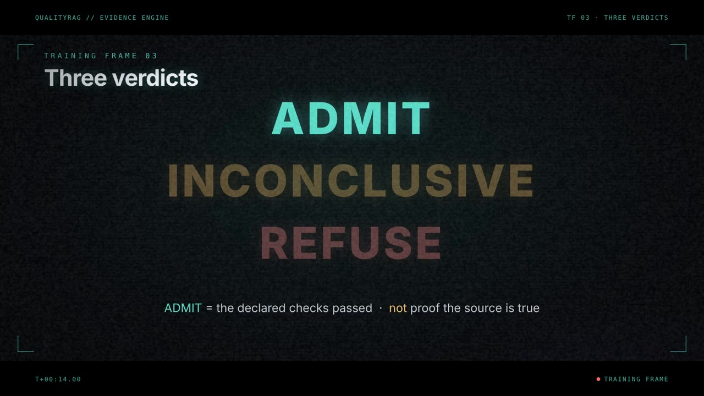
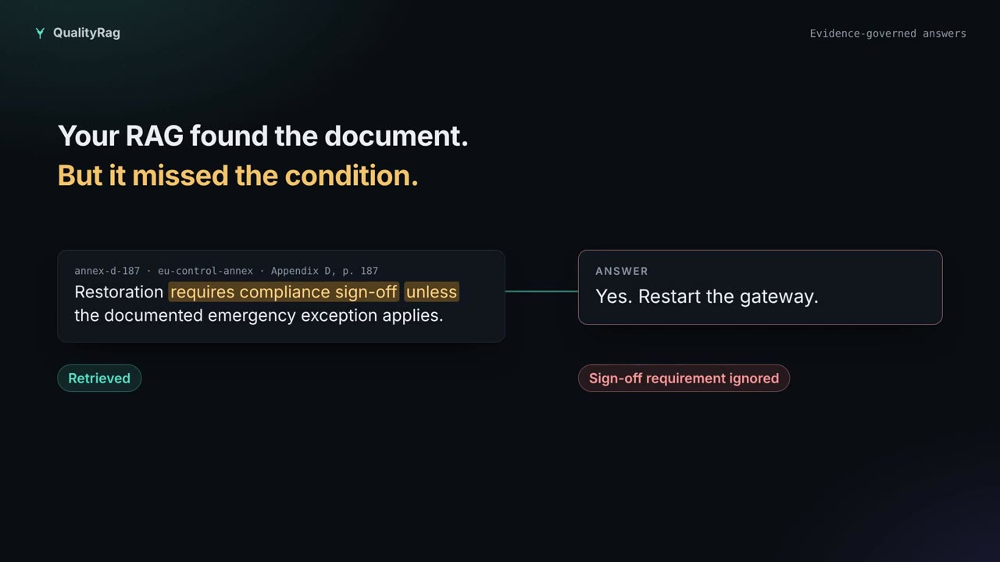
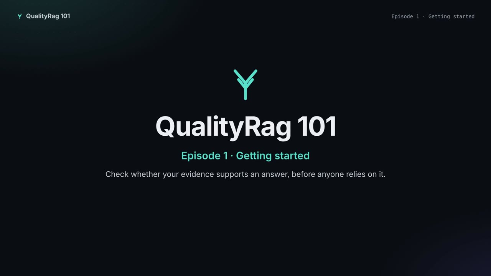

# QualityRag 101: video series

This is a short animated course, made for people who are new to QualityRag. No presenter appears in it. Each episode has two parts: an animated explanation, then a narrated recording of the real console running on a fresh local install. Everything you see on screen is a command or a click you can repeat yourself.

| # | Episode | You will be able to | Status |
|---|---------|---------------------|--------|
| 1 | **Getting started** | install QualityRag, sign in, check your first answer, and read the result | [Watch](episode-01-getting-started/episode-01-getting-started.mp4) |
| 2 | Fixing what Health finds | work through each Health finding and confirm the fix | planned |
| 3 | Testing a stricter policy | use the policy tester and advisor, then replay a change on a branch | planned |
| 4 | Bring your own documents | load your own passages and requirements in place of the sample data | planned |
| 5 | Research tree and AI agents | follow branches, siblings and the Gardener, and connect an agent over MCP | planned |
| 6 | Alternatives and Evolution | compare alternatives, and promote a policy through Evolution | planned |

The episodes are meant to be watched in order, and each one builds on the one before.

## Flagship film · The Evidence Engine (2 min 12 s)

[](film-01-evidence-engine/qualityrag-the-evidence-engine.mp4)

This is a cinematic overview, told in six training frames:

1. **The deceptive witness:** evidence that looks like support but isn't. It might be a copy of the same original, an incident report treated as authority, or a superseded runbook.
2. **The law:** a versioned PackSpec declares the requirements, independent sources and freshness, and the same contract runs in ten SDK languages.
3. **Three verdicts:** *admit*, *inconclusive* or *refuse*. When evidence is missing, the gap is named. *Admit* means only that the declared checks passed.
4. **Live engine:** the real console, filmed. Removing one memo changes the verdict.
5. **The Semantic Garden:** an append-only research tree that people and AI agents grow through `PROPOSE`, `CHALLENGE`, `TEST`, `SYNTHESIZE`, `PRUNE` and `REOPEN`.
6. **Evolution:** candidates compete with the champion on fresh, held-out families, under the same PackSpec.

The Garden and Evolution frames show how the research loop is designed. They are not results: the README's acceptance boundary still applies. The meters in frame 6 are illustrative, not measurements.

## QualityRag Academy: twenty problems, one episode each

**Chapters A1–A8 are built:** videos, interactive chapters and labs are in [docs/academy](../academy/README.md).

Each Academy episode opens on a failure that RAG teams describe in their own words. It then demonstrates what QualityRag does about that failure, and states what it does *not* guarantee. The first five are the customer-acquisition episodes.

| Order | Episode (the complaint) | What QualityRag shows | Status |
|---|---|---|---|
| A1 | "It found the right document but gave the wrong answer." · "It misses critical exceptions." | Requirements checked one by one; `unless` and `only` flagged for a person | Available now |
| A2 | "It confidently invents an answer when the evidence is missing." | `INCONCLUSIVE` withholds the answer and names the gap | Available now |
| A3 | "Three sources agree, but they all copied the same original." · "The citations don't support the answer." | Same-origin copies count once; only passages linked to a requirement count | Available; authoritative provenance verification is still a gap |
| A4 | "It uses outdated policies." · "Two documents contradict each other." | `max_age_seconds`; `REFUSE` on recorded contradiction | Available (age and declared contradictions only) |
| A5 | "My PDF tables are completely messed up." | Structure-preserving representation (Semantic Codex) | Research preview |
| A6 | "It can't combine several documents." | Cross-document relationships in typed grammar | Built · available pattern + research |
| A7 | "It can't understand diagrams, images and video." | Semantic Store prototypes | Built · research preview |
| A8 | "Right rule, wrong customer or region." | Purpose-scoped lenses | Built · available pattern + research |
| A9 | "It works with one PDF, fails with more." | Duplicates counted once; unlinked passages excluded | Available (partial) |
| A10 | "Chunking is destroying the context." | Conditional wording flagged; typed spans | Partial |
| A11 | "The answer is in my documents, but RAG can't find it." | Not a retriever: names what is missing so the app can re-retrieve | Partial |
| A12 | "We can't measure whether our RAG is improving." | Policy tester, deceptive-witness fixtures, Evolution | Experimental |
| A13 | "Excellent in the demo, unreliable in production." | Held-out families; Health | Experimental |
| A14 | "Every change breaks something." | Policy changes, branch replay, signed promotion | Experimental |
| A15 | "We can't guarantee who sees which documents." | Signed tokens with scopes (not a document access-control system) | Partial |
| A16 | "Too slow and expensive at scale." | The evaluator needs no model call; representation cost is researched in the Garden | Research |
| A17 | "Vector search can't find exact product codes." | Out of scope: pair QualityRag with keyword or hybrid retrieval | Not addressed |
| A18–A20 | Deep dives: the deceptive witness, PackSpec authoring, the Semantic Garden | From the flagship film | Planned |

## Homepage cut (51 seconds)

[](homepage-45s/qualityrag-homepage-45s.mp4)

This is a short, customer-facing version for a landing page. It opens on the failure: *your RAG found the document, but missed the condition*. It then compares a conventional answer with QualityRag's per-requirement check, and shows the real console zoomed in as the result drops from *supported* to *not enough evidence*. It ends with GitHub and the DODO LLC reliability pilot.

- [With captions](homepage-45s/qualityrag-homepage-45s.mp4): for autoplay-muted embeds.
- [Without captions](homepage-45s/qualityrag-homepage-45s-nocaptions.mp4): for players that load [VTT](homepage-45s/qualityrag-homepage-45s.vtt) or [SRT](homepage-45s/qualityrag-homepage-45s.srt) captions.

## Episode 1 · Getting started (about 3 minutes)

[](episode-01-getting-started/episode-01-getting-started.mp4)

1. **Why a check?** A RAG system answers even when its passages don't support the answer.
2. **The check.** Your policy lists what an answer needs. For each requirement, the check counts independent sources and rejects evidence that is stale or contradicted. The result is *supported*, *not enough evidence*, or *contradicted*.
3. **Two details.** Copies of the same document count once. Conditional words such as *unless* are highlighted so that a person reads them.
4. **Hands on.** Clone, install, `bootstrap`, `serve`, then sign in.
5. **Check an answer.** Run a check, inspect a requirement, untick a passage and check again, then open Health.

These are the commands from the episode:

```sh
git clone https://github.com/cyrillesaxo/QualityRag.git && cd QualityRag
pip install -r tools/activation_runtime/requirements.txt
python -m tools.activation_runtime.bootstrap --root ~/qualityrag-local
python -m tools.activation_runtime.cli serve --root ~/qualityrag-local/state \
  --keys ~/qualityrag-local/public-keys.json --port 8769
# open http://127.0.0.1:8769 and paste the token from ~/qualityrag-local/browser-token.txt
```

Each episode folder holds the video, with captions burnt in, plus the captions as [WebVTT](episode-01-getting-started/episode-01-getting-started.vtt) and [SRT](episode-01-getting-started/episode-01-getting-started.srt).

## How the videos are made

The videos are built from code, so anyone can rebuild them from this folder.

- `episode-NN-*/script.json` is the source of truth. It holds the narration, sentence by sentence. Animation scenes use `say`. Console scenes use `steps`, where each step pairs a sentence with a console action.
- `render/scenes.{html,css,js}` draw the animation scenes as a deterministic function of time, `render(scene, t, marks)`. Each frame is screenshotted at 1920×1080 and 30 fps.
- `render/render.py` produces the finished episode:
  1. It synthesises the narration.
  2. It times every scene to its sentences.
  3. It films the console scenes against a real `bootstrap` + `serve` in headless Chromium. Each step is paced to the moment its sentence starts.
  4. It encodes one file per scene, joins them, and mixes in the audio.
  5. It writes `.vtt`, `.srt` and a version with burnt-in captions.

To rebuild an episode, you need Python 3.11+, Playwright with Chromium, ffmpeg with libass, and the [Kokoro](https://github.com/thewh1teagle/kokoro-onnx) voice model:

```sh
pip install kokoro-onnx playwright
mkdir -p voice && for f in kokoro-v1.0.onnx voices-v1.0.bin; do
  curl -L -o voice/$f https://github.com/thewh1teagle/kokoro-onnx/releases/download/model-files-v1.0/$f; done
python docs/training/render/render.py docs/training/episode-01-getting-started --voice-dir voice --out out/ep1
# preview individual frames before a full render:
python docs/training/render/render.py docs/training/episode-01-getting-started --voice-dir voice --out out/ep1 --stills gate:16
```

To add an episode, copy the episode 1 folder, rewrite `script.json`, and add any new animation scenes to `scenes.js`. You can reuse the console actions in `render.py`, or add new ones there.

## Credits

- **Narration voice:** [Kokoro-82M](https://huggingface.co/hexgrad/Kokoro-82M) (Apache-2.0), voice `af_bella`. Run locally with [kokoro-onnx](https://github.com/thewh1teagle/kokoro-onnx) (MIT). To change the narrator, set `voice` in `script.json`.
- **Film score:** synthesised by `render.py` (`mix_score`) as a low drone with scene impacts, ducked under the voice. It uses no third-party music.
- **Typeface:** [Inter](https://rsms.me/inter/) (SIL Open Font License).
- **Sample data, console and engine:** this repository.
